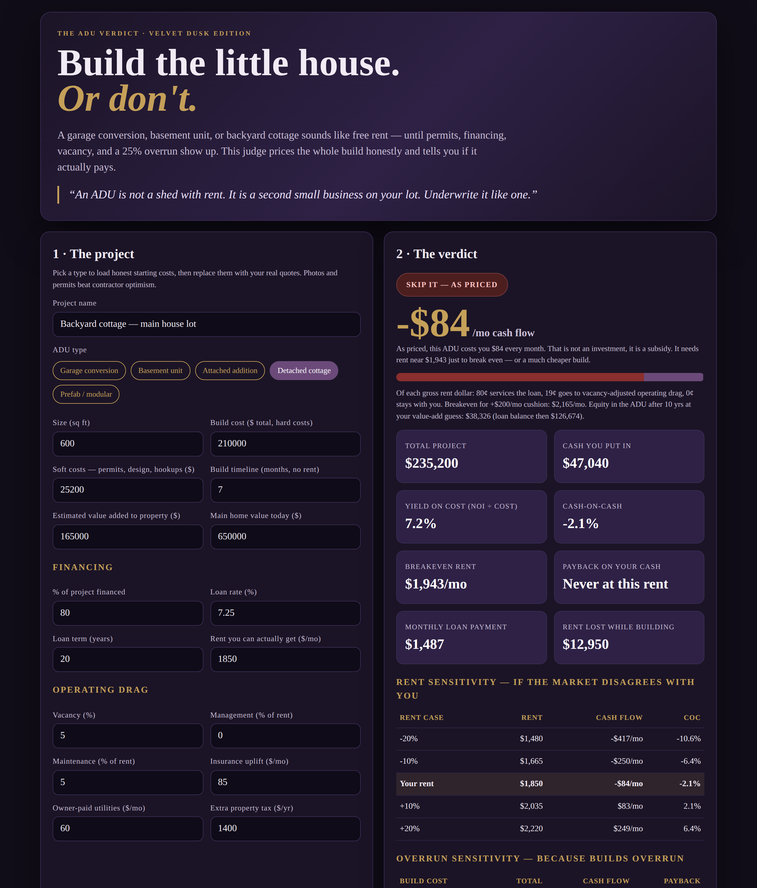

# The ADU Verdict

**Live:** https://thebullbrew.github.io/adu-verdict/
**Repo:** https://github.com/thebullbrew/adu-verdict

## What it does
Should you build that garage conversion, basement unit, attached addition, prefab, or detached backyard cottage? Enter the real build cost, soft costs (permits, design, hookups), financing, achievable rent, and operating drag — and get a straight verdict: **BUILD IT / CLOSE — THINK TWICE / SKIP IT — AS PRICED**, with monthly cash flow after debt service, yield on cost, cash-on-cash return, breakeven rent (and breakeven for a +$200/mo cushion), payback on your cash, rent lost while building, a rent anatomy bar, equity after 10 years, rent sensitivity (−20% to +20%), and cost-overrun sensitivity (+0% to +50%). Five ADU-type presets load honest starting costs. Scenarios save on-device and export as a copyable summary.

## The method behind it
- **Yield on cost is the tell.** NOI ÷ total project cost. If a finished rental down the street yields more than your build, you built an expensive way to buy income. Around 6.5%+, building starts to beat buying.
- **Value added ≠ project cost.** Spending $235k does not add $235k to an appraisal. The tool keeps them separate — that gap is where most ADU pitches lie.
- **Breakeven rent is solved, not guessed**, accounting for vacancy, management, and maintenance as percentages of rent, plus fixed insurance, utilities, and reassessment drag against the actual amortized loan payment.
- **Overruns and delay are priced**, because builds overrun and every build month is a month of rent you did not collect.

Check zoning, owner-occupancy rules, separate metering, parking, STR bans, and reassessment before the math matters — no spreadsheet survives an illegal unit.

## How to run
Open `docs/index.html` in any browser, or visit the live link above. No backend, no build step, no data leaves the device. Installable as a PWA and works offline after first load.

Design: Dark old-money variation 11 — Velvet Dusk (purple-black `#110D18`, velvet panel `#1B1426`, gold `#C5A059`, velvet violet `#6B4A7A`, italic serif verdict quotes, soft dramatic shadows).
